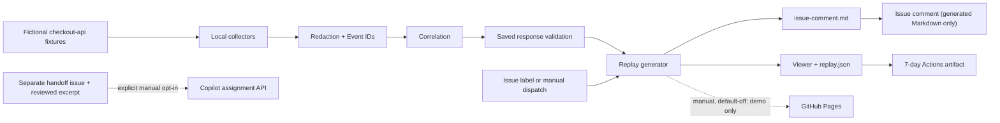

# Incident Replay

Incident Replay collects, redacts, and correlates service events. It can
prepare an analysis prompt, validate saved model responses locally, or make an
explicitly enabled analysis request through the GitHub Copilot CLI.
`fixtures/` holds the fictional `checkout-api` and replay examples. The demo,
offline analysis validation, and report generation never call a model.

## Author

Kalpesh Panchal

## Validate records

Use Node.js 20+; no install is needed. The [Event](src/schemas/event.schema.json)
and [Hypothesis](src/schemas/hypothesis.schema.json) contracts use JSON Schema
Draft 2020-12. For parsed JSON records, `require('./src/validate.cjs')` exports
`validateEvent(record)` and `validateHypothesis(record)`. Each returns
`{ valid, errors }`, with field paths in the errors.

Events require a source reference and use UTC timestamps ending in `Z` (no
leap seconds). `signature` and `trace_id` are optional. Hypotheses require at
least one distinct evidence ID; validation checks the IDs' shape, not whether
they resolve to events.

```sh
node --test
```

The complete fictional demo command shown below was measured locally with Node
v26.13.1 using `/usr/bin/time -p`:
`real 0.06`, `user 0.05`, `sys 0.01` seconds.

## Collect and redact events

The CommonJS collectors return `{ events, redactionReport }`. Events conform
to the existing Event schema. The report contains a total and per-category
replacement counts, never the original values. Collectors redact free-form
fields including message text, service, signature, trace ID, and source
reference before returning results. Event IDs are derived from redacted
metadata. If any part of a trace ID matches a redaction rule, the entire
`trace_id` field is omitted and its matches still count in the report. Those
events cannot be grouped by trace ID, but they will not falsely share a
placeholder. Unchanged trace IDs remain available for grouping.
Keep source files local: the file collectors never make network
requests, and the GitHub collector only makes read-only REST requests using
the repository and query parameters, not local fixture or log data.

Redaction is **best-effort, not a guarantee** that all secrets or personal
data have been removed. It recognizes common AWS and GitHub credentials,
labeled secrets, high-entropy strings, email addresses, IPv4/IPv6 addresses,
and Luhn-valid card numbers. Encoded, unusually formatted, and unlabeled
low-entropy values can be missed; ordinary identifiers can be masked.
Review the output before sharing it outside the local trust boundary.
`require('./collectors/redact.cjs').redactEvents(events)` also accepts
already-valid Event arrays for standalone use.

Run this example from the repository root with Node.js 20+ (no install):

```sh
node <<'NODE'
const { collectLogs } = require('./collectors/log.cjs');
const { collectAlerts } = require('./collectors/alert.cjs');

async function main() {
  const options = { service: 'checkout-api' };
  for (const result of [
    await collectLogs('fixtures/ingestion/checkout.jsonl', options),
    await collectLogs('fixtures/ingestion/checkout.log', options),
    await collectAlerts('fixtures/ingestion/alerts.json', options),
  ]) console.log(JSON.stringify(result, null, 2));
}
main().catch((error) => { console.error(error.message); process.exitCode = 1; });
NODE
```

- **Logs:** A `.jsonl` file uses one object per nonblank line, with `ts` or
  `timestamp`, `text` or `message`, optional `severity` or `level`, and
  optional `service`, `signature`, and `trace_id`. Other files default to
  plain text: start each nonblank line with a zoned ISO timestamp (optionally
  in brackets), followed by an optional severity label and the message. Set
  `format: 'jsonl'` or `format: 'text'` to override the extension. Supply a
  fallback `service` when the records do not specify one. References include
  the file path and physical line number.
- **Alerts:** Supply a JSON array with `ts` or `timestamp`, `text` or
  `message`, and optional `severity` (defaults to `warn`), `service`,
  `signature`, and `trace_id`. The `service` option is the fallback.
  References include the path and one-based record number.

Timestamps require `Z` or a numeric UTC offset, are normalized to UTC,
and retain fractional precision. Malformed input fails the batch; errors do
not include input records or contents.

For GitHub, set `GH_TOKEN` or `GITHUB_TOKEN` in the environment if your
repository or rate limit requires authentication. Use read access to Contents,
Pull requests, Deployments, and Actions. For example:

```js
const { collectGitHub } = require('./collectors/github.cjs');
const result = await collectGitHub({
  repo: 'owner/repo',
  since: '2026-11-18T13:00:00Z',
  until: '2026-11-18T14:00:00Z',
  service: 'checkout-api', // optional; defaults to the repository name
});
```

The window is inclusive. Commits from the default branch use committer
time; pull requests emit opening and merge or unmerged-close events;
deployments and Actions runs use creation time. The Event sources are
`commit`, `pr`, `deploy`, and `actions_run`, respectively. PR signatures
distinguish opening, merging, and closing without a merge. Results
are sorted by event time. The collector reads paginated repository metadata;
it does not fetch Actions logs, artifacts, or deployment statuses. GitHub tests
use mocked REST responses and make no live requests.

## Correlate an incident

Pass reviewed, redacted collector Events to `correlateEvents` in
[`src/correlate.cjs`](src/correlate.cjs). For example, given the combined
Event array and the IDs of a known deployment and commit:

```js
const { correlateEvents } = require('./src/correlate.cjs');
const replay = correlateEvents(events, {
  sourceOffsetsMs: { alert: -250 }, // subtract 250 ms from a fast alert clock
  deploymentChanges: [{ deploymentId, commitId, files: ['src/quote.js'] }],
});
```

- `events` contains copies with corrected UTC timestamps, sorted by timestamp
  then Event ID, preserving sub-millisecond precision. `normalizeEvents`
  exposes just this step. IDs and original records are unchanged.
- `errorClusters` groups error and critical log/alert Events by service and
  signature. If no signature is provided, it uses the first message line
  with numeric tokens and whitespace normalized. `traces` groups explicitly
  present unmasked trace IDs across services; omitted IDs never match.
- `buckets` counts error/critical Events as a share of all log/alert Events
  in each populated UTC interval `[startMs, startMs + bucketMs)`. The default
  bucket is one minute. `changePoint` marks the first boundary where the rate
  rises by `minRateIncrease` (default 0.25), comparing adjacent populated
  buckets with at least `minBucketEvents` (default 1) records each. Gaps do not
  count as healthy baselines, and no qualifying rise returns `null`.
- `suspects` scores commits explicitly linked to deployments strictly before
  that boundary. Each distinct changed file matching a Node.js stack frame
  from an error at or after the boundary in the deployed service adds one
  point. Relative paths match exactly; absolute paths match by repository
  path suffix. Ties favor newer deployments, then commit and deployment ID.
  Only the best-ranked deployment per commit is returned. Ranking is a
  heuristic, not evidence of causation.

The GitHub collector does not provide deploy-to-commit links or changed
files. Supply those as local, reviewed metadata in `deploymentChanges`, using
Event IDs and already-redacted repository-relative file paths. No metadata is
fetched and no commit is inferred from timing alone.

GitHub collection uses at most 10 pages per endpoint, a 10-second request
timeout, and a 30-second total time budget. It retries rate limits and transient
server/network failures at most twice, honoring `Retry-After` within the time
budget. When a source fails after another source completed, the result includes
explicit `warnings` and `omissions`; already-collected pages may be retained and
are marked partial. If no source completes, collection throws instead of
returning an empty success-shaped result. Error and warning strings contain
status/reason labels only, never response bodies or credentials.

## Prepare, validate, and optionally run analysis

```js
const { buildAnalysisPrompt, validateAnalysisResponse } = require('./src/analyze.cjs');
const prompt = buildAnalysisPrompt(replay.events); // { system, user }, no request is sent
const analysis = validateAnalysisResponse(savedResponseText, replay.events);
```

Only supply already-redacted Events and use the exact same evidence set for
prompt construction and validation. The prompt builder applies the Phase 1
checks again and rejects detectable unredacted fields, treating Phase 1's
SHA-256 Event IDs as opaque identifiers. This check is not a substitute for
reviewing the collector output. The offline example carries only Event data,
not deployment metadata or raw source records.

The [analysis schema](src/schemas/analysis.schema.json) requires
`hypotheses` and `timeline` arrays. Every claim must cite at least one distinct
evidence ID; offline snapshots use Event IDs, and opt-in analyses can also cite
reviewed diff IDs. Invalid JSON or a schema violation (including absent or
empty citations) rejects the response. A well-formed claim that cites any
unknown ID is removed and reported in `rejected` by array name and index
without echoing its content. Retained prose also passes through best-effort
redaction. Resolved IDs establish that the cited records exist, not that they
prove the claim. Golden tests replay local response snapshots in
`fixtures/analysis/`; no test contacts a model.

For an explicitly enabled live analysis, install and authenticate the GitHub
Copilot CLI separately, then pass the complete correlation result and only
reviewed, already-redacted diff hunks for files matched by local suspect
ranking:

```js
const { analyzeWithCopilot } = require('./src/analyze.cjs');
const analysis = await analyzeWithCopilot(replay, {
  enabled: true,
  model: 'gpt-6-astra', // optional; otherwise Copilot CLI chooses
  suspectDiffs: [{
    path: 'src/quote.cjs',
    patch: '@@ -4,1 +4,1 @@\n- old total\n+ new total',
    reviewed: true,
  }],
});
```

[GitHub Models inference has been retired](https://docs.github.com/en/github-models);
the live adapter uses the supported
Copilot CLI's non-interactive prompt mode. Calls are disabled unless
`enabled: true` is supplied. The adapter runs from an empty temporary working
directory, disables built-in MCP servers and custom instructions, and allows
only the `ask_user` tool while disabling it with `--no-ask-user`. It passes the prompt through stdin
rather than command-line arguments and sends the correlated Event records,
correlation summary, and supplied reviewed diffs to Copilot. Copilot may retain
session data under its own policies; review those policies before opting in.
The CLI must be
installed and authenticated already; the adapter does not install or update
it, and it makes no request during the demo or report generation.

Diffs must have `reviewed: true`, pass the collector's redaction checks, and
match a locally ranked suspect file. Each patch is limited to 64 KiB, with
256 KiB total across patches and 512 KiB for the full prompt. Each is assigned an opaque `diff-…`
evidence ID. Claims that cite unknown evidence are omitted; suspect file paths
are retained only when the hypothesis cites the reviewed diff for that exact
path. Live results can be added to a replay input as `analysis`, alongside the
same `correlation` options and `suspectDiffs` array. The generated viewer
includes only those validated, reviewed hunks; clicking a diff evidence ID
opens its exact path and patch in the evidence drawer. Nothing fetches a diff
from GitHub, and the model's conclusions still require human review.
The result includes a `rejected` list for claims removed during validation;
review it before saving the `hypotheses` and `timeline` as `analysis`.

## Render a replay and review an issue comment

Run the complete fictional demo locally. It collects the JSONL, text-log, and
alert fixtures, redacts them, adds fictional deployment/change metadata,
correlates the events, validates the saved analysis response, and generates
all three replay artifacts:

```sh
node src/generate-replay.cjs --demo /tmp/incident-replay-demo octobooth-19/incident-replay
```

The output contains `replay.json`, `index.html`, and `issue-comment.md`. The
viewer shows the detected error-rate rise and deployment-linked candidate
scores. Re-run the same command to reproduce the bundle. This is a local,
fictional-fixture run; it uses no network, model, or real incident data.

Open the generated `index.html` directly in a browser, or open
[`viewer/index.html`](viewer/index.html) and select the generated `replay.json`.
No server or network connection is needed. Use the slider (including arrow keys),
Previous/Next buttons, or a claim's Evidence buttons to open the corresponding event.
`issue-comment.md` is a concise preview for manual posting **after review**. It
preserves event IDs in citations and only links recognized same-repository GitHub
references or paths tracked at the current Git commit (`path:line` and `path#Lline`
are supported). Unrecognized refs, including local-only paths, remain text. Omit
`owner/repo` to render without links.

Replace `--demo` with a local input JSON file for a real replay. Its
`events` must already be redacted, `redactionReport` is the collector's
`{ total, counts }` (sum corresponding categories when combining collectors),
and `analysis`, if present, is the saved response object described above.
Optional `correlation` accepts the existing correlation options. Without
analysis, the comment falls back to the event timeline and makes no hypotheses.
When using GitHub API Events, also pass through the collector's `warnings` and
`omissions` arrays so partial collection is shown in both the replay and comment.
Keep real inputs and outputs local unless approved for sharing; automated
redaction cannot guarantee removal of all sensitive data.

### GitHub Actions

Enable Actions and create the `incident` label. On the default branch, applying
that label generates the replay and posts only the generated, sanitized
`issue-comment.md` to the same issue. The workflow never reads the issue body
or comments. A manual dispatch can target an issue; a blank target runs only
the fictional demo. A public repository always runs the fictional demo, even
if an issue number is supplied. In a private repository, a numbered run uses
`incidents/<issue-number>.json` from the default branch and fails if the input
is missing. Review and redact that file before committing it; repository
history, generated comments, and artifacts all retain incident data within
their respective audiences.

The comment has the issue's audience: it is public on public issues and visible
to repository-authorized users on private issues. The downloadable Actions
artifact contains the viewer and report files, is available to users with
Actions read access, and expires after seven days. Issue comments follow the
repository's normal issue retention and are not removed automatically.

GitHub Pages is a separate manual-dispatch option, **off by default**. When
enabled, it always builds and publishes the fictional demo only; issue inputs
and private replay files are not used in that job. To use it, enable Pages with
GitHub Actions as the build/deploy source and allow the workflow's `pages: write`
and `id-token: write` job permissions. Pages visibility follows repository and
GitHub plan settings; treat a public site as public data.

### Opt-in Copilot handoff

Enable Copilot cloud agent for the repository and organization, and use an
eligible GitHub user with write access. Handoff is never triggered by the
`incident` label. For the CLI, in a **private** repository, prepare a dedicated
open handoff issue. Review its title, body, and comments so Copilot isn't given
any raw incident context. Review the generated Markdown and trim it to the
relevant redacted evidence (at most 16 KB). Then run:

```sh
# Set COPILOT_ASSIGNMENT_TOKEN in the environment first; do not commit it.
node src/assign-copilot.cjs --reviewed owner/private-repo 123 /path/to/reviewed-report.md
```

This uses GitHub's [documented REST issue assignment](https://docs.github.com/en/copilot/how-tos/use-copilot-agents/cloud-agent/use-cloud-agent-via-the-api#using-the-rest-api).
Use a fine-grained user token scoped to only the private repository and store it
as the repository Actions secret `COPILOT_ASSIGNMENT_TOKEN`; do not use or expose
the workflow's `GITHUB_TOKEN`. GitHub documents Metadata read and Actions,
Contents, Issues, and Pull requests read/write permissions for the assignment
API. Avoid an organization-wide or classic token where the fine-grained
permissions suffice.

The manual workflow also has an explicit `assign_copilot` checkbox (default
false) and a separate open `handoff_issue_number`. It requires a numbered,
reviewed private input in `incidents/<issue-number>.json`; assignment uses only
the generated `issue-comment.md` (at most 16 KB). Only the handoff step receives
`COPILOT_ASSIGNMENT_TOKEN`; it requires a private repo, an open issue not
already assigned, and the explicit manual control. Workflow-dispatch inputs
contain no evidence text. The issue body is never read. Tests do not assign
anyone. The assignment asks Copilot to use only the reviewed excerpt,
demonstrate a focused test failing against unchanged code, and propose a fix
in a draft PR without merging. These are instructions, not access controls; the
maintainer must review the PR and confirm the failing baseline and draft status.

## Architecture



## Timed demo storyboard

This 60-second script is the fallback storyboard if a screen recording is not
available. Use the generated bundle from the command above and keep the demo
offline:

| Time | Show |
| --- | --- |
| 0:00–0:08 | Run `node src/generate-replay.cjs --demo /tmp/incident-replay-demo octobooth-19/incident-replay`. |
| 0:08–0:20 | Open `/tmp/incident-replay-demo/index.html`; point out the fictional checkout timeline and local-only viewer. |
| 0:20–0:34 | Scrub to the error-rate rise and use an Evidence button to open its event in the drawer. |
| 0:34–0:48 | Show the deployment-linked candidate score, then explain that correlation is heuristic, not causation. |
| 0:48–1:00 | Open `issue-comment.md`; note that the comment is a generated preview and no issue or agent was contacted locally. |

No live incident data, model call, issue creation, assignment, or deployment is
part of the local demo. The macOS screen recorder failed in this environment
and produced no video file; this storyboard is not a recording, and video
capture remains outstanding.

The workflow, Pages deployment, live comment posting, and Copilot assignment
have not been exercised against GitHub. Posting and assignment endpoint tests
use mocked REST responses; the local demo is fully offline.

## Reproduce the checkout regression

The CLI quotes a fixed cart with two $25 items. The correct result is $50 with
free shipping. The refactor drops item quantity, so the demo actually quotes
$25 plus $5 shipping, for a $30 total.

```sh
node fixtures/checkout-api/quote.cjs
node --test fixtures/checkout-api/quote.regression.cjs  # intentionally exits 1
git --no-pager log --oneline -- fixtures/checkout-api
git --no-pager show 23555e8 -- fixtures/checkout-api/quote.cjs
```

To run the same regression test against the good commit without changing your
current branch:

```sh
git worktree add --detach ../incident-replay-baseline 90d3400
(cd ../incident-replay-baseline && node --test fixtures/checkout-api/quote.regression.cjs)
git worktree remove ../incident-replay-baseline
```
